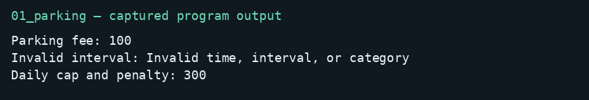

# Smart Parking Fee Management

## Problem statement
Calculate a parking charge from entry and exit timestamps, vehicle type, daily caps and penalties.

## Objectives
Validate time and ordering; calculate started hours and capped charges.

## Assumptions
Times are integer tuples (day, hour, minute), day starts at 1; car/bike/truck hourly rates are ₹20/₹10/₹40. Each elapsed 24-hour block is capped at 10 hourly charges; the final partial block is capped likewise. A lost ticket adds ₹100. Exit must be later than entry.

## Algorithm
Convert times to absolute minutes; reject invalid dates, intervals or types; divide duration into 24-hour blocks; round residual time up to hours and cap at 10; add penalty.

## Flowchart
```text
  (Start)
     |
 [Read sample data]
     |
 <Input valid?> -- No --> [Report error] --+
     | Yes                                |
 [Process records / compute result]        |
     |                                    |
 [Report results]                         |
     +------------------------------------+
     |
   (End)
```
The processing box represents the loop and decisions detailed in the pseudocode.

## Pseudocode
```text
READ entry, exit, vehicle, lost_ticket
VALIDATE times, order, vehicle
IF invalid THEN report error ELSE
  DIVIDE duration into full 24-hour blocks and remainder
  CHARGE capped hours in each block
  IF lost_ticket THEN add 100
  PRINT charge
END IF
```

## Python source code
See [01_parking.py](01_parking.py). Run with `python 01_parking.py`.

## Test cases
(1,22,00) to (2,02,30), car → ₹100; exit before entry → error; 24 hours, car, lost ticket → ₹300. Additional boundary: 1 minute, bike → ₹10; hour 24 → error.

## Output screenshot


[Accessible captured output](01_parking_output.txt). The image is rendered from actual captured execution output.

## Conclusion
Caps are per elapsed 24-hour block, not calendar days; overnight is represented by the next day number.
