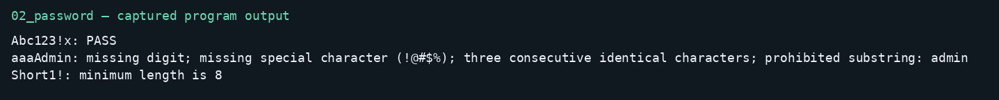

# Password Policy Validation Engine

## Problem statement
Evaluate each candidate and explain every rule it violates.

## Objectives
Use string scanning and conditional checks to collect failures.

## Assumptions
At least 8 characters; ASCII uppercase, lowercase, digit and a character from !@#$%; reject three identical consecutive characters and case-insensitive password or admin substrings.

## Algorithm
Scan each character for categories; check length; scan consecutive triples; check prohibited words; print all failures or PASS.

## Flowchart
```text
  (Start)
     |
 [Read sample data]
     |
 <Input valid?> -- No --> [Report error] --+
     | Yes                                |
 [Process records / compute result]        |
     |                                    |
 [Report results]                         |
     +------------------------------------+
     |
   (End)
```
The processing box represents the loop and decisions detailed in the pseudocode.

## Pseudocode
```text
FOR each password
  SET category flags and failure list
  SCAN characters and consecutive triples
  CHECK length and prohibited substrings
  PRINT all failures or PASS
END FOR
```

## Python source code
See [02_password.py](02_password.py). Run with `python 02_password.py`.

## Test cases
Abc123!x → PASS; aaaAdmin → missing digit and special, repetition, admin; Short1! → length failure.

## Output screenshot


[Accessible captured output](02_password_output.txt). The image is rendered from actual captured execution output.

## Conclusion
This educational policy is not a substitute for production authentication or secure password storage.
