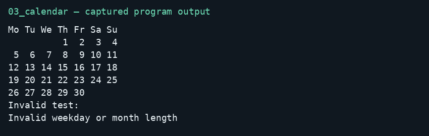

# Nested Loop Calendar Generator

## Problem statement
Print a month with dates aligned to the supplied starting weekday.

## Objectives
Validate month length and weekday; build and print aligned weeks.

## Assumptions
Monday is 0 and Sunday is 6; valid supplied lengths are 28–31. No month/year is supplied, so leap-year and specific-month validity cannot be inferred.

## Algorithm
Validate inputs; print weekday header; add initial spaces; loop over weeks and weekdays, adding leading spaces or dates; print each completed or partial week.

## Flowchart
```text
  (Start)
     |
 [Read sample data]
     |
 <Input valid?> -- No --> [Report error] --+
     | Yes                                |
 [Process records / compute result]        |
     |                                    |
 [Report results]                         |
     +------------------------------------+
     |
   (End)
```
The processing box represents the loop and decisions detailed in the pseudocode.

## Pseudocode
```text
READ start and days
IF invalid THEN print error
ELSE print header and leading spaces
  WHILE dates remain
    FOR weekday = 0 TO 6
      append leading space or next date
    PRINT week
END IF
```

## Python source code
See [03_calendar.py](03_calendar.py). Run with `python 03_calendar.py`.

## Test cases
Start 3 and 30 days → 1 under Thursday and 30 under Friday; start 7 → error; days 27 → error; start 0, 28 → four complete weeks.

## Output screenshot


[Accessible captured output](03_calendar_output.txt). The image is rendered from actual captured execution output.

## Conclusion
The nested week and weekday loops align the supplied month without needing a calendar library.
