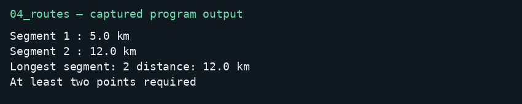

# Tuple-Based Route Distance Analysis

## Problem statement
Find distances between consecutive coordinate tuples and identify the longest segment.

## Objectives
Apply a distance formula and track the maximum.

## Assumptions
Coordinates are planar (x, y) in kilometres. Euclidean distance is √((x₂−x₁)²+(y₂−y₁)²), not geographic great-circle distance. The first segment wins ties.

## Algorithm
Require two points; unpack successive tuples; calculate distances; update the maximum; print the longest.

## Flowchart
```text
  (Start)
     |
 [Read sample data]
     |
 <Input valid?> -- No --> [Report error] --+
     | Yes                                |
 [Process records / compute result]        |
     |                                    |
 [Report results]                         |
     +------------------------------------+
     |
   (End)
```
The processing box represents the loop and decisions detailed in the pseudocode.

## Pseudocode
```text
IF fewer than two points THEN report error
FOR each successive pair
  UNPACK coordinates
  COMPUTE Euclidean distance
  UPDATE longest if larger
PRINT longest
```

## Python source code
See [04_routes.py](04_routes.py). Run with `python 04_routes.py`.

## Test cases
(0,0),(3,4),(3,16) → 5 km, 12 km, segment 2; one point → error; identical points → 0 km.

## Output screenshot


[Accessible captured output](04_routes_output.txt). The image is rendered from actual captured execution output.

## Conclusion
For latitude and longitude a different supplied geographic formula would be necessary.
