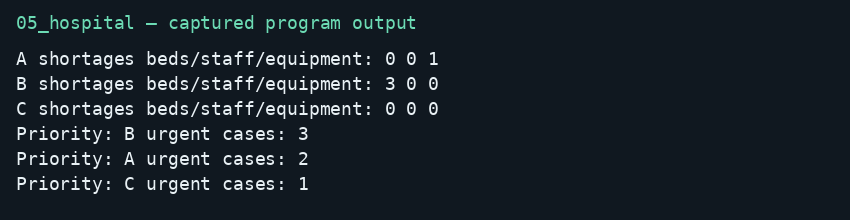

# Hospital Resource Allocation and Capacity Monitoring

## Problem statement
Analyse ward capacity, staffing, equipment and urgent cases.

## Objectives
Compute shortages and list wards by urgency.

## Assumptions
Each ward is [name, occupied, capacity, staff, equipment, urgent]. One staff member per 4 occupied beds and one equipment unit per 5 occupied beds, rounded up. Bed shortage compares urgent cases with free beds; priority is urgent count descending, stable on ties.

## Algorithm
Validate ward counts; compute free beds and required staff/equipment; report shortages; repeatedly select highest-priority ward.

## Flowchart
```text
  (Start)
     |
 [Read sample data]
     |
 <Input valid?> -- No --> [Report error] --+
     | Yes                                |
 [Process records / compute result]        |
     |                                    |
 [Report results]                         |
     +------------------------------------+
     |
   (End)
```
The processing box represents the loop and decisions detailed in the pseudocode.

## Pseudocode
```text
FOR each ward
 VALIDATE counts
 COMPUTE bed, staff and equipment shortfalls
 STORE urgency and name
WHILE wards remain
 SELECT highest urgency and print
```

## Python source code
See [05_hospital.py](05_hospital.py). Run with `python 05_hospital.py`.

## Test cases
A [8,10,3,1,2] → shortages 0,0,1; B [10,10,6,4,3] → 3,0,0 and first priority; occupied > capacity → invalid.

## Output screenshot


[Accessible captured output](05_hospital_output.txt). The image is rendered from actual captured execution output.

## Conclusion
This is a simplified monitoring exercise, not a clinical triage or staffing policy.
