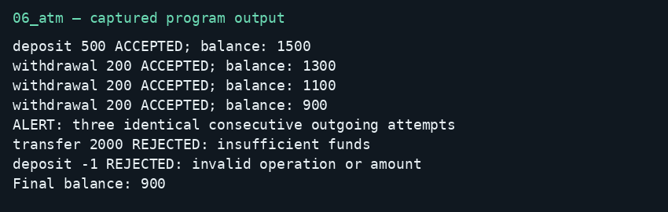

# Multi-Stage ATM Transaction Audit

## Problem statement
Simulate transactions, reject invalid requests and detect repeated outgoing attempts.

## Objectives
Track running balance and a repeated-operation streak.

## Assumptions
Opening balance is nonnegative; amounts must be positive. Withdrawals and transfers cannot exceed current balance; transfers only debit this account. Three identical consecutive positive withdrawal/transfer attempts trigger one alert per streak, including rejected attempts.

## Algorithm
Validate opening balance; compare each operation with the previous one; validate and apply or reject; alert at streak length three; report final balance.

## Flowchart
```text
  (Start)
     |
 [Read sample data]
     |
 <Input valid?> -- No --> [Report error] --+
     | Yes                                |
 [Process records / compute result]        |
     |                                    |
 [Report results]                         |
     +------------------------------------+
     |
   (End)
```
The processing box represents the loop and decisions detailed in the pseudocode.

## Pseudocode
```text
SET balance and streak
FOR each transaction
 UPDATE identical-attempt streak
 IF operation invalid OR funds insufficient THEN reject
 ELSE update balance
 IF outgoing streak equals 3 THEN alert
PRINT final balance
```

## Python source code
See [06_atm.py](06_atm.py). Run with `python 06_atm.py`.

## Test cases
Opening 1000, deposit 500, three withdrawals 200 → alert and 900; transfer 2000 → reject; deposit −1 → reject; final 900.

## Output screenshot


[Accessible captured output](06_atm_output.txt). The image is rendered from actual captured execution output.

## Conclusion
Alert is a simple heuristic, not proof of fraud; no external recipient ledger is simulated.
