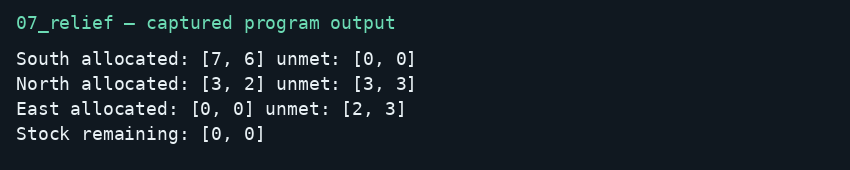

# Disaster Relief Supply Allocation

## Problem statement
Allocate limited multi-item stocks among areas and report unmet needs.

## Objectives
Use urgency ordering and prevent allocations beyond stock or demand.

## Assumptions
Stock and needs are nonnegative integer lists in the order water, food. Higher numeric urgency is served first; input order breaks ties. Each area receives up to its full requirement before the next area.

## Algorithm
Validate stock and area demands; copy stock; repeatedly select the most urgent area; allocate min(stock, need) per product; report unmet and remaining stock.

## Flowchart
```text
  (Start)
     |
 [Read sample data]
     |
 <Input valid?> -- No --> [Report error] --+
     | Yes                                |
 [Process records / compute result]        |
     |                                    |
 [Report results]                         |
     +------------------------------------+
     |
   (End)
```
The processing box represents the loop and decisions detailed in the pseudocode.

## Pseudocode
```text
VALIDATE stock and area requirements
COPY stock and areas
WHILE areas remain
 SELECT highest urgency
 FOR each supply
  GIVE minimum of stock and requirement
  UPDATE stock and unmet demand
 PRINT allocation and unmet
PRINT remaining stock
```

## Python source code
See [07_relief.py](07_relief.py). Run with `python 07_relief.py`.

## Test cases
Stock [10,8], South urgency 5 needs [7,6] → [7,6]; North urgency 2 needs [6,5] → [3,2], unmet [3,3]; East → unmet [2,3]. Negative stock → invalid.

## Output screenshot


[Accessible captured output](07_relief_output.txt). The image is rendered from actual captured execution output.

## Conclusion
The greedy policy is illustrative; operational allocation should use an authorised policy.
