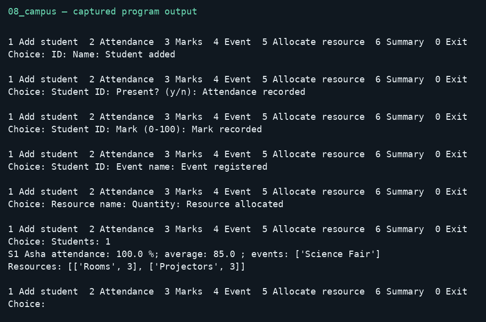

# Comprehensive Smart Campus Management Simulation

## Problem statement
Manage students, attendance, marks, events and shared resources from a menu.

## Objectives
Integrate nested records, validation and summary reports.

## Assumptions
Data exists in memory only. IDs are unique; marks are integers 0–100; attendance is recorded one session at a time. Events cannot be registered twice by one student. Resources start with 5 rooms and 3 projectors and allocation reduces stock.

## Algorithm
Display menu until exit; add a unique student or find a student for updates; validate and record attendance, marks and events; allocate resources; show summary.

## Flowchart
```text
  (Start)
     |
 [Read sample data]
     |
 <Input valid?> -- No --> [Report error] --+
     | Yes                                |
 [Process records / compute result]        |
     |                                    |
 [Report results]                         |
     +------------------------------------+
     |
   (End)
```
The processing box represents the loop and decisions detailed in the pseudocode.

## Pseudocode
```text
REPEAT
 DISPLAY menu and read choice
 IF add THEN validate and append student
 ELSE IF attendance/marks/event THEN find and update student
 ELSE IF resource THEN validate and subtract quantity
 ELSE IF summary THEN print student and resource totals
 ELSE IF exit THEN stop
 ELSE print error
UNTIL exit
```

## Python source code
See [08_campus.py](08_campus.py). Run with `python 08_campus.py`.

## Test cases
Add S1 Asha; present; mark 85; register Science Fair; allocate 2 rooms → summary 100% attendance, average 85, 3 rooms left. Duplicate ID → rejected; mark 101 → rejected; allocate more than stock → rejected.

## Output screenshot


[Accessible captured output](08_campus_output.txt). The image is rendered from actual captured execution output.

## Conclusion
Restarting the program clears all records; persistence and authentication are outside this syllabus.

**Sample interactive input:** `1, S1, Asha, 2, S1, y, 3, S1, 85, 4, S1, Science Fair, 5, Rooms, 2, 6, 0` (one entry per prompt).
