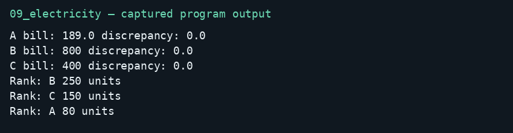

# Smart Electricity Billing for Multiple Apartments

## Problem statement
Calculate progressive apartment bills, compare recorded bills and rank consumption.

## Objectives
Apply slabs, fixed charge and rebate; report differences and ranking.

## Assumptions
First 100 units ₹2/unit; next 100 ₹3/unit; remainder ₹5/unit; fixed ₹50. If units ≤100, rebate is 10% of the entire subtotal including fixed charge. Discrepancy = recorded minus calculated bill. First input wins consumption ties.

## Algorithm
Compute each slab and fixed charge; apply rebate where eligible; compare recorded with calculated; repeatedly select largest consumption.

## Flowchart
```text
  (Start)
     |
 [Read sample data]
     |
 <Input valid?> -- No --> [Report error] --+
     | Yes                                |
 [Process records / compute result]        |
     |                                    |
 [Report results]                         |
     +------------------------------------+
     |
   (End)
```
The processing box represents the loop and decisions detailed in the pseudocode.

## Pseudocode
```text
FOR each apartment
 VALIDATE units
 CALCULATE progressive slabs and fixed charge
 IF eligible THEN apply rebate
 PRINT bill and recorded minus calculated
RANK valid apartments by consumption descending
```

## Python source code
See [09_electricity.py](09_electricity.py). Run with `python 09_electricity.py`.

## Test cases
80 units → ₹189; 150 → ₹400; 250 → ₹800; recorded 810 for 250 → discrepancy +10; negative units → invalid.

## Output screenshot


[Accessible captured output](09_electricity_output.txt). The image is rendered from actual captured execution output.

## Conclusion
Tariffs are illustrative and not an actual utility tariff.
