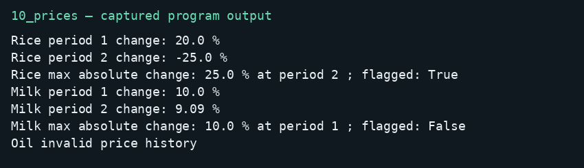

# Multi-Product Price Fluctuation Analysis

## Problem statement
Analyse sequential product prices and flag large percentage changes.

## Objectives
Compute signed changes, track largest absolute change and compare to threshold.

## Assumptions
All prices must be positive; at least two prices are needed. Change = (new−old)/old ×100. Flag when maximum absolute change strictly exceeds the nonnegative threshold. First period wins ties.

## Algorithm
Validate threshold and each history; calculate changes between consecutive values; track greatest absolute change and period; flag if above threshold.

## Flowchart
```text
  (Start)
     |
 [Read sample data]
     |
 <Input valid?> -- No --> [Report error] --+
     | Yes                                |
 [Process records / compute result]        |
     |                                    |
 [Report results]                         |
     +------------------------------------+
     |
   (End)
```
The processing box represents the loop and decisions detailed in the pseudocode.

## Pseudocode
```text
IF threshold negative THEN error
FOR each product
 VALIDATE price history
 FOR each successive price pair
  COMPUTE percentage change
  UPDATE maximum absolute change
 PRINT maximum and threshold flag
```

## Python source code
See [10_prices.py](10_prices.py). Run with `python 10_prices.py`.

## Test cases
Rice [100,120,90] → +20%, −25%, max 25%, flagged at threshold 20; Milk [50,55,60] → max 10%, not flagged; [0,5] → invalid.

## Output screenshot


[Accessible captured output](10_prices_output.txt). The image is rendered from actual captured execution output.

## Conclusion
The analysis uses period-to-period percentage change, not absolute monetary movement.
